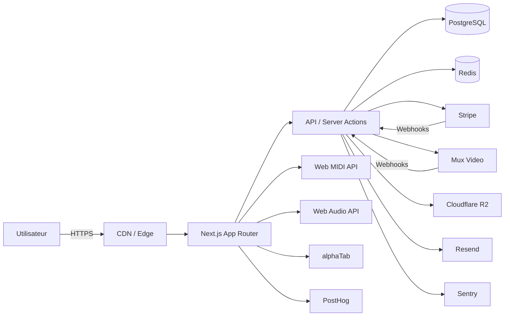

# Cahier des charges — LearnBatterie

**Plateforme web d'apprentissage de la batterie, en français**

| | |
|---|---|
| Version | 1.0 |
| Date | 20 octobre 2026 |
| Statut | Proposition à valider |
| Nom de travail | LearnBatterie (nom marketing à définir) |
| Périmètre | MVP web desktop-first, marché francophone |
| Rédaction | Analyse marché + benchmark + spécifications produit et technique |

> **Note de méthode.** Ce document synthétise une recherche web menée en octobre 2026 (concurrents, prix, pédagogie, technologies, cadre légal). Les faits sourcés sont signalés par un renvoi en annexe. Les choix produit sont assumés comme des **propositions** : ils sont marqués « décision proposée » et peuvent être arbitrés avant le lancement du développement.

---

## 0. Synthèse exécutive

**Le produit.** Une plateforme par abonnement qui apprend à jouer de la batterie à des adultes francophones, du premier rythme au jeu en groupe. Elle combine trois briques que les acteurs actuels séparent :

1. **Un parcours structuré** (quoi travailler, dans quel ordre, combien de temps).
2. **Un feedback objectif en temps réel** sur batterie électronique (justesse rythmique, notes manquées, régularité).
3. **Un répertoire de morceaux et play-alongs** pour transformer la technique en plaisir de jouer.

**La promesse.** « 20 minutes par jour, un plan clair, et tu entends les progrès. »

**La cible.** Adultes de 18 à 50 ans, débutants ou faux débutants, équipés d'une batterie électronique ou d'un pad, qui veulent apprendre sans professeur, sans contrainte d'horaire, et sans se perdre dans YouTube.

**Le marché.** L'enseignement musical en ligne pèse environ **4,61 Md$ en 2026** et pourrait atteindre **9,36 Md$ en 2031** (CAGR 15,23 %). Les applications représentent **50,75 %** des revenus et les cours auto-rythmés **49,05 %** (Mordor Intelligence). La batterie reste un segment plus petit que le piano ou la guitare, mais très engagé, avec des concurrents rentables et un fort potentiel de rétention.

**Le positionnement.** Drumeo vend du contenu premium et une communauté ; Melodics vend du jeu rythmique et du feedback MIDI ; Drum Coach vend un plan de pratique personnalisé. **LearnBatterie vend les trois ensemble, en français, à un prix inférieur à Drumeo, avec une pédagogie explicite et un vrai accompagnement de progression.**

**Le modèle.** Freemium + abonnement : **12,99 €/mois ou 99 €/an**, essai de 7 jours, garantie 30 jours. Offre B2B écoles/professeurs en V2.

**Le MVP.** 6 mois, 3 niveaux, 90 cours, 120 exercices, 30 play-alongs, moteur MIDI, tableau de progression, paiement, back-office. Budget cible : **350 à 500 k€** selon l'ambition de production vidéo.

**Le risque principal.** Les droits musicaux. Diffuser des reprises de morceaux célèbres exige des licences de composition **et** de master. Le MVP doit donc reposer sur des compositions originales et des titres sous licence, pas sur des « drumless tracks » récupérés sur YouTube.

---

## 1. Contexte et problème

### 1.1 Le constat

Apprendre la batterie seul est devenu paradoxalement plus facile et plus difficile qu'il y a dix ans.

- **Plus facile** : YouTube regorge de cours gratuits, les batteries électroniques d'entrée de gamme coûtent moins de 400 €, et les applications de jeu rythmique sont accessibles.
- **Plus difficile** : l'offre est fragmentée, non séquencée, majoritairement anglophone, et presque jamais capable de dire à l'élève **s'il joue juste**. L'immense majorité des débutants abandonne entre le 3e et le 6e mois, au moment où la coordination devient difficile et où les premiers cours gratuits ne suffisent plus.

### 1.2 Les cinq frustrations dominantes

Recherches et discussions communautaires (r/drums, r/edrums, avis Trustpilot, blogs spécialisés) font ressortir cinq points récurrents :

1. **« Je ne sais pas quoi travailler. »** Trop de vidéos, pas de progression. L'élève saute de sujet en sujet, recommence les mêmes bases, stagne.
2. **« Je ne sais pas si je joue juste. »** Sans professeur, personne ne corrige le timing, la posture, les ghost notes, la tenue de baguette. Les app de play-along donnent une note, mais pas un diagnostic.
3. **« Je décroche. »** La motivation chute quand les progrès deviennent invisibles. Le manque de routine et l'absence de feedback tuent la régularité.
4. **« C'est cher ou contraignant. »** Un cours particulier coûte en moyenne **25 à 30 €/h** en France ; il faut se déplacer, trouver un créneau, parfois acheter une batterie acoustique insonorisée.
5. **« Je ne trouve pas de contenu en français. »** Les leaders (Drumeo, Melodics, Mike's Lessons) sont anglophones. L'offre française existe (imusic-school) mais reste centrée sur la vidéo, sans feedback temps réel ni parcours adaptatif.

### 1.3 Le problème à résoudre

> **Les adultes débutants francophones n'ont pas d'outil qui leur dit quoi pratiquer, qui écoute leur jeu et qui les garde motivés assez longtemps pour atteindre l'autonomie.**

C'est ce problème — et non « produire encore des cours vidéo » — que le produit doit résoudre.

### 1.4 Pourquoi maintenant

- Les batteries électroniques d'entrée de gamme (Alesis Nitro Max ~399 €, Roland TD-02K à partir de ~349 €) ont démocratisé la pratique silencieuse.
- Le Web MIDI permet, sans application native, de lire le jeu d'un kit électronique dans Chrome/Edge.
- Les bibliothèques de notation (alphaTab) et les synthétiseurs Web Audio permettent une partition interactive et un play-along synchronisé dans le navigateur.
- Les modèles d'abonnement sont acceptés pour l'apprentissage (Drumeo revendique **121 849 élèves** ; Melodics et Drum Coach vivent du même modèle).
- L'IA générative réduit le coût de production de contenus dérivés (traductions, fiches, quiz), sans remplacer la validation pédagogique.

---

## 2. Étude de marché et concurrence

### 2.1 Chiffres clés

| Indicateur | Valeur | Source |
|---|---|---|
| Marché mondial de l'enseignement musical en ligne (2026) | 4,61 Md$ | Mordor Intelligence |
| Prévision 2031 | 9,36 Md$ | Mordor Intelligence |
| CAGR 2026–2031 | 15,23 % | Mordor Intelligence |
| Part des applications dans les revenus (2025) | 50,75 % | Mordor Intelligence |
| Part des cours auto-rythmés (2025) | 49,05 % | Mordor Intelligence |
| Part des cours en tête-à-tête (2025) | 47,10 % | Mordor Intelligence |
| Croissance des offres hybrides | 16,6 %/an | Mordor Intelligence |
| Prix moyen d'un cours particulier de batterie en France | 25–30 €/h | Superprof, ProfesseurParticulier |
| Prix d'un kit électronique débutant | 349–399 € | Idealo, Alesis |
| Support navigateur du Web MIDI | ~78 % (Chrome, Edge, Opera, Samsung, Firefox avec add-on ; pas Safari/iOS) | MDN, TestMu AI |

> **Prudence.** Les cabinets d'études donnent des estimations très divergentes (de 2,6 à 5,7 Md$ selon les périmètres). Les ordres de grandeur et la tendance comptent plus que le chiffre exact. Le marché de la **batterie** n'est pas isolé dans ces rapports : il faut le considérer comme un sous-segment à fort engagement, pas comme l'intégralité du marché « musique ».

### 2.2 Benchmark concurrentiel

| Acteur | Positionnement | Prix constaté (oct. 2026) | Forces | Limites | Ce qu'on en retient |
|---|---|---|---|---|---|
| **Drumeo** (Musora) | Le Netflix de la batterie : contenu premium, professeurs célèbres, morceaux | 30 $/mois ou 279 $/an ; formule cours seuls 25 $/mois ou 229 $/an ; essai 7 j | 2 500+ morceaux, 200+ cours, méthode en 4 niveaux, communauté de 121 849 élèves, garantie 90 j, multi-instruments | Anglophone, prix élevé, feedback temps réel limité, surcharge de contenu pour un débutant | Le contenu et la crédibilité pédagogique sont la référence. On ne les battra pas sur le volume : on les bat sur le feedback et le français. |
| **Melodics** | App de pratique rythmique par MIDI, proche du jeu vidéo | Standard 10,99 $/mois en annuel (131,88 $) ; Premium 14,99 $/mois (179,88 $) ; mensuel 29,99–34,99 $ ; 20 cours gratuits | Feedback immédiat, progression par niveaux, ludique, fonctionne avec kits et pads | Nécessite un contrôleur MIDI ; peu de pédagogie explicite ; catalogue de morceaux variable ; interface parfois frustrante (avis Trustpilot) | Le feedback est un moteur de rétention. Mais le jeu ne remplace pas l'apprentissage de la musique. |
| **Drum Coach** (Upbeat) | Coach de pratique assisté par IA, plan quotidien | 59,99 $/an ; 249,99 $ à vie ; feedback professeur 12,99 $ ; essai 7 j | Plan personnalisé, 1 000+ exercices, stats, fonctionne acoustique/électro/pad, 25 000 utilisateurs actifs, 4,7/5 | Contenu vidéo plus léger, pas de grand catalogue de morceaux, anglais | La personnalisation et la routine sont des leviers puissants. |
| **Mike's Lessons** | Cours d'un professeur reconnu, communauté | 269,90 $/an ; essai 7 j | Qualité d'enseignement, feedback personnalisé, communauté | Un seul professeur, anglais, pas d'outil temps réel | La relation humaine reste un différenciateur ; on peut l'intégrer en V2 (feedback asynchrone). |
| **Drum Channel** | Streaming de cours et masterclasses | Abonnement | Bibliothèque de légendes, production soignée | Anglophone, expérience vieillissante, peu interactif | Le contenu « legend » attire les intermédiaires, pas les débutants. |
| **imusic-school** | École de musique en ligne française, multi-instruments | 9,90 €/mois en promo, 14,90 €/mois standard | Français, milliers de vidéos, styles variés, masterclasses, outils (métronome, partitions) | Très orienté vidéo, pas de feedback MIDI, parcours peu adaptatif | C'est le concurrent français direct. Notre avantage : la pratique interactive et le coaching. |
| **YouTube** | Contenu gratuit infini | Gratuit | Accessibilité, variété, communautés | Aucune structure, aucune correction, publicité, dispersion | Le principal concurrent n'est pas une entreprise : c'est le « je regarde des vidéos et je ne pratique pas ». |
| **Professeur particulier** | Cours humain, présentiel ou visio | 25–30 €/h en moyenne | Correction immédiate, motivation, personnalisation | Prix, déplacement, horaires, disponibilité | Le pair-à-pair reste la référence de qualité. Le produit doit s'y comparer, pas le nier. |

### 2.3 Analyse SWOT

| Forces | Faiblesses |
|---|---|
| Positionnement français inédit ; feedback temps réel + parcours + morceaux ; prix inférieur à Drumeo ; expérience desktop optimisée pour la pratique ; pédagogie explicite. | Marque inconnue ; catalogue initial limité ; dépendance au Web MIDI (pas de Safari/iOS) ; coût de production vidéo ; pas de réseau social intégré. |
| **Opportunités** | **Menaces** |
| Marché en croissance ; fragmentation des concurrents ; essor des batteries électroniques ; demande de contenu francophone ; partenariats avec marques de kits ; B2B écoles. | Drumeo/Melodics peuvent franciser ou baisser leurs prix ; piratage de contenu ; hausse du coût d'acquisition ; droits musicaux ; lassitude des abonnements ; contenu gratuit. |

### 2.4 Positionnement retenu

**Pour** les adultes francophones qui débutent ou reprennent la batterie,
**qui** veulent progresser sans professeur et sans se perdre dans les vidéos,
**LearnBatterie** est une **plateforme d'apprentissage guidée**
**qui** combine un parcours structuré, un feedback objectif sur leur jeu et des morceaux jouables,
**contrairement à** Drumeo (contenu passif, anglais, cher) et Melodics (jeu sans pédagogie),
**notre différence** est de **transformer chaque session en progrès mesurable, en français, sur le kit que l'élève possède déjà**.

**Énoncé de marque (proposition).** *« Ton coach de batterie. Pas juste des vidéos. »*

### 2.5 Facteurs clés de succès

1. **La qualité du parcours** : un débutant doit savoir quoi faire dès la première session, sans réfléchir.
2. **La fiabilité du feedback** : une note fausse ou un décalage de latence détruit la confiance plus vite qu'une fonctionnalité manquante.
3. **La régularité** : le produit doit créer une habitude de 15–20 minutes, pas une bibliothèque de consultation.
4. **Le répertoire** : jouer un morceau reconnu est le principal moteur de plaisir et de rétention.
5. **La confiance** : pédagogie validée par des professeurs, garantie, transparence sur les limites (notamment acoustique).

---

## 3. Cibles et personas

### 3.1 Segmentation

| Segment | Part estimée du marché adressable | Besoin dominant | Proposition |
|---|---|---|---|
| **Débutant absolu** (0–6 mois) | ~55 % | Savoir par où commencer, tenir un rythme, ne pas se décourager | Parcours « Découverte », 10 min/jour, feedback bienveillant |
| **Faux débutant** (6–24 mois) | ~30 % | Structurer, combler les lacunes, jouer des morceaux | Parcours « Fondations » et « Groove », diagnostic, play-alongs |
| **Intermédiaire** (2–5 ans) | ~12 % | Progresser sur des points précis (ghost notes, independence, jazz, métal) | Ateliers ciblés, morceaux avancés, feedback détaillé |
| **Professeur / école** | ~3 % | Suivre des élèves, gagner du temps | Tableau de bord B2B, devoirs, rapports (V2) |

### 3.2 Personas

#### Persona 1 — Thomas, 34 ans, débutant, Lyon

- **Situation.** Ingénieur, deux enfants. Il a acheté une Alesis Nitro Max il y a trois mois. Il a regardé « 10 beats faciles » sur YouTube, sait jouer un rock basique, mais se sent bloqué.
- **Objectif.** Jouer « Highway to Hell » avec des amis dans six mois, sans prendre de cours.
- **Frustrations.** Ne sait pas quoi travailler ; confond vitesse et progrès ; n'ose pas jouer devant les autres ; 20 minutes maximum par session.
- **Attentes.** Un plan quotidien, des exercices courts, un retour clair, des morceaux motivants.
- **Critère de succès.** « En 4 semaines, je joue un morceau complet sans regarder la partition. »

#### Persona 2 — Sofia, 27 ans, reprise après 10 ans

- **Situation.** A joué en école de musique adolescente, a arrêté. Aujourd'hui en appartement, kit électronique, casque.
- **Objectif.** Retrouver son niveau, développer le groove et l'indépendance, jouer du funk.
- **Frustrations.** Les cours débutants sont trop lents ; les cours avancés supposent des bases qu'elle n'a plus ; elle veut du feedback précis, pas des encouragements génériques.
- **Attentes.** Diagnostic initial, parcours accéléré, exercices ciblés, statistiques de régularité.
- **Critère de succès.** « Je sens que mon hi-hat et ma caisse claire sont plus stables. »

#### Persona 3 — Marc, 45 ans, batteur acoustique, Bordeaux

- **Situation.** Joue depuis 5 ans en groupe amateur, jamais pris de cours. Veut progresser sans acheter de kit électronique.
- **Objectif.** Améliorer le timing, les fills, la lecture, la créativité.
- **Frustrations.** Les apps exigent un kit MIDI ; les cours en ligne sont trop généraux ; il ne veut pas investir dans du matériel.
- **Attentes.** Cours vidéo, partitions, métronome, play-alongs, auto-évaluation ; pas de scoring obligatoire.
- **Critère de succès.** « J'ai un plan d'entraînement même sans feedback automatique. »

#### Persona 4 — Nadia, 38 ans, professeure de batterie

- **Situation.** Donne 25 cours/semaine, cherche des supports numériques et un suivi entre les cours.
- **Objectif.** Assigner des exercices, voir la progression, gagner du temps de préparation.
- **Attentes (V2).** Espace classe, devoirs, rapports, licences élèves.
- **Critère de succès.** « Mes élèves pratiquent entre deux cours et arrivent préparés. »

### 3.3 Jobs-to-be-done

- *Quand je m'assois à la batterie, je veux savoir exactement quoi jouer pendant 20 minutes, pour ne pas perdre de temps à choisir.*
- *Quand je joue, je veux savoir si je suis en rythme et quelles notes je manque, pour corriger immédiatement.*
- *Quand je progresse, je veux le voir et l'entendre, pour rester motivé.*
- *Quand j'ai un doute sur ma posture ou ma technique, je veux une réponse claire, sans chercher 40 vidéos.*
- *Quand j'ai 15 minutes, je veux une session utile, pas un cours de 45 minutes.*

---

## 4. Objectifs et indicateurs

### 4.1 Objectifs produit

| Objectif | Indicateur | Cible à 6 mois post-lancement |
|---|---|---|
| Faire jouer dès le premier jour | % d'inscrits réalisant une session de pratique < 24 h | ≥ 60 % |
| Créer une habitude | Sessions de pratique / utilisateur actif / semaine | ≥ 2,5 |
| Faire progresser | % d'utilisateurs terminant le niveau 1 | ≥ 35 % |
| Retenir | Rétention D30 des inscrits | ≥ 25 % |
| Convertir | Trial → payant | ≥ 10 % |
| Satisfaire | NPS | ≥ 40 |
| Fiabiliser | Taux de sessions sans bug bloquant | ≥ 99,5 % |

### 4.2 Objectifs business (12 premiers mois)

| Indicateur | Cible |
|---|---|
| Comptes créés | 15 000 |
| Abonnés payants | 1 200 |
| ARR | ~119 k€ (ARPU ~99 €/an) |
| CAC blended | < 35 € |
| Churn mensuel | < 5 % |
| LTV/CAC | > 3 |
| Marge brute | > 80 % |

> Ces cibles supposent un lancement France/Belgique/Suisse romande, un budget marketing de 50–80 k€ et un bouche-à-oreille correct. Elles sont à recalculer après la bêta.

### 4.3 Objectifs techniques

| Domaine | Cible |
|---|---|
| Latence perçue (MIDI → feedback) | < 30 ms sur configuration recommandée |
| Précision du scoring | > 95 % sur banc de test de 500 séquences |
| Disponibilité | 99,9 % |
| LCP p75 | < 2,5 s |
| INP p75 | < 200 ms |
| CLS | < 0,1 |
| Démarrage vidéo | < 2 s |
| API p95 | < 300 ms |
| Accessibilité | WCAG 2.2 AA / RGAA 4.1 |

### 4.4 Non-objectifs (MVP)

- Réseau social complet, messagerie, live streaming.
- Cours en visioconférence avec professeur.
- Marketplace de professeurs.
- Application native iOS/Android (reportée en V2).
- Scoring automatique sur batterie acoustique (reporté en V2, micro).
- Cours pour enfants (V3).
- Multi-instruments (guitare, piano) avant validation du modèle batterie.

---

## 5. Périmètre fonctionnel

### 5.1 Vue d'ensemble

| Épic | MVP | V1 | V2 |
|---|---|---|---|
| Compte et onboarding | ✅ | | |
| Diagnostic initial | ✅ | | |
| Parcours et cours vidéo | ✅ | | |
| Partition interactive | ✅ | | |
| Practice room MIDI | ✅ | | |
| Play-alongs et morceaux | ✅ (30) | +30 | +60 |
| Progression et statistiques | ✅ | | |
| Rappels et notifications | ✅ (email) | push | |
| Communauté | | ✅ | |
| Feedback professeur asynchrone | | | ✅ |
| Espace professeur / B2B | | | ✅ |
| Application mobile native | | | ✅ |
| Scoring acoustique | | | ✅ |
| Multi-langue | | ✅ (EN) | |
| Mode hors-ligne | | ✅ | |
| Gamification avancée | ✅ (base) | | |

### 5.2 Parcours d'onboarding

**Objectif :** personnaliser le plan en moins de 3 minutes et lancer une première pratique en moins de 5 minutes.

Étapes :

1. **Création de compte** (email ou Google/Apple).
2. **Questionnaire** : objectif (jouer des morceaux / progresser / reprendre / se défouler), niveau auto-évalué, temps disponible, genres préférés, type de kit (électro / acoustique / pad / aucun).
3. **Test de niveau optionnel** (5 min) : reproduire 3 rythmes à tempo lent, 3 rudiments de base, 1 lecture de partition simple. Si l'utilisateur n'a pas de kit MIDI, le test est remplacé par un questionnaire vidéo.
4. **Configuration du kit** : détection MIDI, mapping automatique ou manuel, calibration de latence.
5. **Génération du plan** : 3 sessions/semaine, 20 min, objectif à 4 semaines.
6. **Première session guidée** : un groove simple, feedback, félicitation, aperçu du prochain cours.

**Critères d'acceptation :**

- L'utilisateur peut sauter le test et modifier son niveau plus tard.
- Si aucun périphérique MIDI n'est détecté, l'interface bascule en mode « cours + partition + métronome » sans bloquer.
- Le plan est recalculé chaque semaine selon la progression.

### 5.3 Diagnostic et plan personnalisé

**Fonctions :**

- Test de niveau adaptatif (branchement selon réussite/échec).
- Détection des lacunes : timing, indépendance, lecture, rudiments, dynamique.
- Génération d'un plan hebdomadaire : échauffement (3 min), technique (7 min), morceau/exercice (8 min), bilan (2 min).
- Ajustement automatique : si l'élève échoue 2 fois, baisse du tempo ou décomposition ; s'il réussit 3 fois, augmentation.
- Possibilité de choisir une session « libre » (exercice, morceau, rudiment).

**Règles pédagogiques :**

- Tempo de départ = 60–70 % du tempo cible.
- Validation d'un exercice : 3 réussites consécutives à ≥ 90 % de précision, ou 2 réussites à tempo cible.
- Ne jamais proposer un exercice dont les prérequis ne sont pas validés.
- Maximum 3 objectifs par session.

### 5.4 Cours et parcours

**Structure :** Parcours → Niveau → Module → Leçon → Exercice.

**Fiche de cours :**

- Objectif pédagogique en une phrase.
- Prérequis.
- Vidéo principale (3–6 min) avec chapitres et sous-titres.
- Partition interactive synchronisée.
- Explications clés (3 puces maximum).
- Exercice guidé (tempo progressif, boucle).
- Play-along.
- Auto-évaluation (« je me sens à l'aise / pas encore »).
- Leçon suivante recommandée.

**Fonctions :**

- Reprise de la lecture à l'endroit quitté.
- Vitesse de vidéo 0,5× à 1,5×.
- Mode « écran de pratique » plein écran.
- Marquer comme terminé / à revoir.
- Notes personnelles.
- Téléchargement PDF de la partition (premium).

**Critères d'acceptation :**

- La vidéo et la partition restent synchronisées au changement de vitesse.
- La progression est enregistrée même hors-ligne (V1).
- Un cours peut être consulté sans MIDI.

### 5.5 Practice room (cœur du produit)

**Objectif :** faire jouer l'élève avec un retour immédiat, sans friction.

**Interface :**

- Partition ou grille rythmique au centre, curseur synchronisé.
- Métronome avec accent sur le temps 1, click on/off, count-in 1 mesure.
- Transport : play/pause, boucle A/B, tempo (40–200 %), compensation de latence.
- Feedback : anneau de score, précision timing (early/late), notes manquées, série en cours.
- Carte du kit : kick, snare, hi-hat, toms, cymbals ; highlight de la note attendue.
- Mode « pas à pas » : une mesure à la fois, puis enchaînement.
- Mode « sans pression » : pas de score, seulement le curseur et le métronome.
- Enregistrement audio (micro) optionnel pour s'écouter (V1).

**Modes de pratique :**

1. **Guidé** : l'élève suit la partition, le tempo augmente progressivement.
2. **Boucle** : répétition d'une mesure ou d'une section.
3. **Play-along** : morceau complet, avec ou sans click, avec ou sans pistes de batterie.
4. **Rudiment** : exercice de caisse claire, scoring main gauche/droite.
5. **Libre** : métronome seul, sans partition.

**Critères d'acceptation :**

- Le feedback apparaît en < 30 ms après la frappe sur une configuration recommandée.
- La calibration de latence est accessible en un clic et persistée par appareil.
- Le score ne pénalise pas une note légèrement en avance/retard dans la tolérance choisie.
- L'élève peut rejouer la même section sans recharger la page.
- Les événements MIDI sont enregistrés de façon agrégée (pas de capture brute durable sans consentement).

### 5.6 Play-alongs et bibliothèque de morceaux

**Fonctions :**

- Catalogue filtrable : niveau, genre, tempo, technique travaillée, durée.
- Fiche morceau : histoire, difficulté, compétences, tempo original, version ralentie.
- Lecteur : pistes (batterie, backing track, click), volume par piste, boucle, ralenti sans changement de hauteur.
- Partition de batterie interactive.
- Mode « écoute » (démonstration) et « joue » (scoring).
- Progression : morceaux commencés, terminés, favoris.

**Catalogue MVP :** 30 morceaux, dont :

- 20 compositions originales (tous droits maîtrisés).
- 6 reprises sous licence (négociées) ou reprises « à la manière de » sans utiliser les masters.
- 4 morceaux traditionnels / domaine public arrangés.

**Critères d'acceptation :**

- Le ralenti conserve la hauteur (time-stretch).
- Le morceau peut être joué sans scoring (mode acoustique).
- Les crédits et licences sont affichés sur chaque fiche.

### 5.7 Progression et statistiques

**Tableau de bord :**

- Série en cours (streak), minutes pratiquées cette semaine, objectif hebdomadaire.
- Niveau actuel, % de complétion, prochaine étape.
- Précision moyenne, régularité (écart-type du timing), notes manquées récurrentes.
- Graphique d'évolution sur 30/90 jours.
- Badges : premier groove, 7 jours de suite, 100 mesures parfaites, premier morceau complet, etc.

**Règles :**

- Les statistiques sont calculées à partir des sessions agrégées.
- L'élève peut supprimer ses données à tout moment.
- Pas de classement public par défaut (option V1).

### 5.8 Communauté (V1)

- Fil de discussion par cours et par morceau.
- Partage d'enregistrements (audio/vidéo) avec consentement.
- Défis mensuels (ex. « 30 jours de rudiments »).
- Modération : charte, signalement, modérateurs, filtre automatique.

### 5.9 Espace professeur / B2B (V2)

- Création de classes, invitation d'élèves.
- Assignation de cours/exercices avec échéance.
- Vue de progression par élève.
- Commentaires asynchrones sur les enregistrements.
- Facturation par siège (8 €/élève/mois, minimum 10 élèves).

### 5.10 Back-office et CMS

- Gestion des cours, modules, exercices, morceaux, partitions, médias.
- Workflow éditorial : brouillon → relecture pédagogique → validation → publié.
- Gestion des traductions.
- Gestion des licences musicales (date d'expiration, territoires, supports).
- Gestion des utilisateurs, abonnements, remboursements, coupons.
- Tableau de bord des KPIs produit.
- Journal d'audit des actions admin.

### 5.11 User stories prioritaires (MoSCoW)

**Must have (MVP)**

| ID | User story | Critères d'acceptation |
|---|---|---|
| US-01 | En tant que visiteur, je veux créer un compte en 30 s pour commencer. | Email + mot de passe ou OAuth ; vérification email ; CGU acceptées. |
| US-02 | En tant que débutant, je veux répondre à un questionnaire pour obtenir un plan adapté. | 6 questions max ; plan généré immédiatement ; modifiable. |
| US-03 | En tant qu'élève, je veux suivre une leçon vidéo avec partition. | Vidéo + partition synchronisées ; reprise ; sous-titres FR. |
| US-04 | En tant qu'élève, je veux brancher mon kit et jouer avec un feedback. | Détection MIDI ; mapping ; calibration ; score en < 30 ms. |
| US-05 | En tant qu'élève, je veux ralentir un exercice pour le maîtriser. | Tempo 40–200 % ; boucle A/B ; count-in. |
| US-06 | En tant qu'élève, je veux voir ma progression. | Dashboard ; streak ; précision ; prochaine étape. |
| US-07 | En tant qu'élève, je veux jouer un morceau complet. | Lecteur multi-pistes ; ralenti ; score ; crédits. |
| US-08 | En tant qu'abonné, je veux gérer mon abonnement. | Stripe Customer Portal ; factures ; annulation en 2 clics. |
| US-09 | En tant qu'admin, je veux publier un cours sans développeur. | CMS ; prévisualisation ; workflow de validation. |
| US-10 | En tant qu'utilisateur, je veux supprimer mes données. | Suppression compte + export ; confirmation ; délai < 30 j. |

**Should have (V1)**

- Notifications push et rappels intelligents.
- Mode hors-ligne (PWA).
- Commentaires et communauté.
- Version anglaise.
- Enregistrement audio et auto-écoute.
- Défis et badges avancés.
- Recommandations personnalisées par genre.

**Could have (V2)**

- Scoring acoustique par micro.
- Application native.
- Feedback professeur asynchrone.
- Espace B2B.
- Multi-instruments.
- MIDI Bluetooth.

**Won't have (MVP)**

- Visio, marketplace, réseau social complet, cours enfants, gamification compétitive publique.

---

## 6. Parcours utilisateurs détaillés

### 6.1 Parcours « premier jour » (nouvel inscrit)

1. **Landing page** → CTA « Teste ton niveau en 5 minutes » (sans carte bancaire).
2. **Compte** → email ou Google.
3. **Questionnaire** → 6 questions.
4. **Détection du kit** → « Branche ton kit en USB et allume-le » ; bouton « Tester » ; si aucun périphérique, proposer le mode sans MIDI.
5. **Calibration** → « Joue 8 coups en rythme avec le clic » ; calcul de l'offset ; confirmation visuelle.
6. **Mini-test** → 3 exercices très simples, feedback encourageant.
7. **Plan** → « Ton programme : 3 sessions de 20 min cette semaine. »
8. **Première session** → 12 minutes guidées, score, badge « Premier groove ».
9. **Email J+1** → rappel personnalisé avec le lien de la session 2.

**Points de friction à éliminer :** installation de logiciel, création de compte avant de jouer, choix du cours, réglage du tempo, compréhension du score.

### 6.2 Parcours « session quotidienne »

1. Ouverture de l'app → dashboard « Ta session du jour » (un seul bouton).
2. Échauffement 3 min (rudiments au pad ou sur le kit).
3. Technique 7 min (exercice du jour, tempo adaptatif).
4. Morceau 8 min (section ciblée ou play-along).
5. Bilan 2 min (score, point fort, point à travailler).
6. Le lendemain : le plan s'adapte (si échec → répétition ; si réussite → nouveau contenu).

### 6.3 Parcours « morceau »

1. Recherche par genre/niveau → fiche morceau.
2. Écoute de la démo → choix du tempo.
3. Apprentissage par sections (4–8 mesures) → boucle → assemblage.
4. Mode play-along avec backing track.
5. Score et badge → partage optionnel.

### 6.4 Parcours « abandon » (rétention)

- Détection : aucune session depuis 3 jours.
- Email « Ton plan t'attend : 12 minutes pour ne pas perdre le rythme ».
- Proposition d'une session courte (5 min) pour casser la spirale.
- Si 14 jours d'inactivité : email de réengagement avec contenu gratuit ou pause d'abonnement.
- Si 30 jours : offre de pause 1 mois plutôt que résiliation (réduit le churn).

### 6.5 Parcours « résiliation »

- Accès au portail Stripe en 2 clics.
- Raisons de départ (sondage 1 question).
- Proposition de pause ou de passage au plan annuel.
- Export des données et des partitions achetées.
- Confirmation immédiate, sans dark pattern.

---

## 7. Contenu pédagogique et curriculum

### 7.1 Principes pédagogiques

Le produit s'appuie sur des principes établis de l'apprentissage moteur et de la pratique délibérée :

- **Pratique délibérée** : objectif précis, feedback immédiat, répétition avec correction.
- **Découpage (chunking)** : une compétence à la fois, mesures courtes, tempo lent.
- **Progression du lent vers le rapide** : maîtrise à 60–70 %, puis +5 BPM.
- **Espacement** : revenir sur les acquis à J+1, J+3, J+7.
- **Entrelacement** : alterner les types d'exercices pour éviter la mémoire de surface.
- **Récupération active** : rejouer sans partition, imiter à l'oreille.
- **Auto-évaluation** : comparer son enregistrement à la démo.
- **80/20** : 80 % du temps à jouer, 20 % à regarder/écouter.

### 7.2 Architecture des niveaux

| Niveau | Durée indicative | Objectifs | Contenus clés |
|---|---|---|---|
| **1. Découverte** | 0–3 mois | Tenir un tempo, jouer un rock simple, lire une grille | Posture, prise de baguette, single strokes, hi-hat/snare/kick, money beat, 8th notes, premiers fills, 8 morceaux |
| **2. Fondations** | 3–9 mois | Groove stable, indépendance de base, 16th notes, dynamique | Double stroke, paradiddles, ghost notes, accents, fills de 1 mesure, 12 morceaux, lecture |
| **3. Groove** | 9–18 mois | Jouer en groupe, styles variés, musicalité | Funk, blues, reggae, rock alternatif, hi-hat ouvert, syncope, 16th, 10 morceaux |
| **4. Autonomie** | 18 mois+ | Créer, improviser, jouer en contexte | Jazz basics, shuffles, latin, métal (option), odd time (initiation), improvisation, 10 morceaux |

### 7.3 Programme type d'un niveau (12 semaines)

| Semaine | Technique | Groove | Morceau | Compétence |
|---|---|---|---|---|
| 1 | Posture, rebond, single stroke | Rock basique | Morceau 1 (section A) | Tenir le tempo |
| 2 | Single stroke 60–100 BPM | Money beat | Morceau 1 (section B) | Coordination |
| 3 | Accents | Variations de kick | Morceau 2 | Dynamique |
| 4 | Double stroke | Hi-hat ouvert | Morceau 2 | Contrôle |
| 5 | Paradiddle | Fill de 1 temps | Morceau 3 | Transition |
| 6 | Révision | Groove + fill | Morceau 3 complet | Fluidité |
| 7 | Ghost notes | Groove funk simple | Morceau 4 | Nuance |
| 8 | 16th notes | Charley 16th | Morceau 4 | Vitesse |
| 9 | Indépendance kick | Groove syncopé | Morceau 5 | Coordination |
| 10 | Lecture | Lecture rythmique | Morceau 5 | Autonomie |
| 11 | Révision | Improvisation | Morceau 6 | Créativité |
| 12 | Bilan | Enregistrement | Morceau final | Validation |

### 7.4 Rudiments

Le curriculum suit les **40 rudiments internationaux PAS**, organisés selon la séquence en 4 tiers de Vic Firth :

- **Tier 1** : single stroke roll, double stroke roll, flam.
- **Tier 2** : single stroke four, single stroke seven, triple paradiddle, 5/9/7 stroke rolls.
- **Tier 3** : 13/15/17/6/10/11 stroke rolls, flammed mill, Swiss Army triplet.
- **Tier 4** : triple stroke roll, pataflafla, ratamacues.

**MVP :** 13 premiers rudiments, avec exercices main droite/main gauche, métronome, scoring, et application au kit (tom/snare).

### 7.5 Styles couverts

- **MVP** : rock/pop, funk, blues.
- **V1** : reggae, jazz (swing de base), latin (bossa/samba initiation), métal.
- **V2** : odd time, drum'n'bass, afrobeat, fusion.

### 7.6 Formats de contenu

| Format | Durée | Usage |
|---|---|---|
| Cours vidéo | 3–6 min | Concept + démonstration |
| Exercice interactif | 1–3 min | Pratique avec score |
| Rudiment | 2–5 min | Technique pure |
| Play-along | 2–5 min | Application musicale |
| Fiche PDF | 1 page | Référence hors écran |
| Quiz | 1 min | Vérification des connaissances |
| Défi | 7–30 jours | Habitude |

### 7.7 Production de contenu (MVP)

| Type | Volume | Effort unitaire | Total |
|---|---|---|---|
| Cours vidéo | 90 | 0,5 j | 45 j |
| Exercices interactifs | 120 | 0,25 j | 30 j |
| Morceaux/play-alongs | 30 | 1,5 j | 45 j |
| Rudiments | 13 | 0,5 j | 6,5 j |
| Fiches PDF | 90 | 0,1 j | 9 j |
| Sous-titres/transcriptions | 90 | 0,1 j | 9 j |
| **Total** | | | **~145 j** (≈ 7 mois-homme) |

> Ce volume suppose une équipe de 3 professeurs/producteurs à temps partiel et un studio mutualisé. Il est le principal poste de coût après les salaires.

### 7.8 Standards de production

- Vidéo 4K, 2 caméras (face + profil), gros plans mains/pieds.
- Audio : micro overhead + close snare/kick, click track.
- Durée max 6 min ; chapitrage ; sous-titres FR (puis EN).
- Partition validée par un professeur avant tournage.
- Fiche pédagogique : objectif, prérequis, erreurs fréquentes, critères de réussite.
- Relecture par un second professeur (4 yeux).
- Charte de présentation : pas de jargon non expliqué, pas de démonstration trop rapide.

---

## 8. Expérience utilisateur et design

### 8.1 Principes

- **Jouer d'abord** : le premier écran après connexion est « Ta session », pas un catalogue.
- **Une action principale par écran** : réduire la charge cognitive.
- **Sombre par défaut** : confort en pièce sombre, mise en valeur de la vidéo et du curseur.
- **Contraste élevé** : lisibilité de la partition et des feedbacks.
- **Grosses cibles** : utilisable sur tablette posée sur un pupitre, avec des baguettes.
- **Pas de dark patterns** : annulation simple, pas de faux compte à rebours.
- **Bienveillance** : le feedback négatif est formulé comme une prochaine étape, jamais comme un jugement.

### 8.2 Écrans clés

1. **Landing** : promesse, démonstration vidéo, preuve sociale, CTA test gratuit.
2. **Dashboard** : session du jour, streak, prochaine étape, accès rapide.
3. **Catalogue** : parcours, morceaux, exercices, filtres.
4. **Fiche cours** : vidéo, objectif, partition, exercice.
5. **Practice room** : partition, transport, feedback, kit map.
6. **Fiche morceau** : difficulté, compétences, lecteur.
7. **Progression** : graphiques, badges, historique.
8. **Réglages** : kit MIDI, calibration, audio, compte, abonnement.
9. **Paywall** : bénéfices, prix, essai, garantie.

### 8.3 Design system

- **Typographie** : une sans-serif lisible (Inter ou équivalent), échelle 14/16/20/28/40.
- **Couleurs** : fond anthracite (#0E1116), surface (#171C24), accent chaud (ambre #F5A524) pour l'action, vert pour la réussite, rouge pour l'erreur, bleu pour l'info. Contraste AA minimum.
- **Composants** : boutons, cartes, tabs, sliders, badges, modales, toasts, tables.
- **Iconographie** : pictogrammes de batterie cohérents (kick, snare, hi-hat, tom, cymbale).
- **Mouvement** : transitions courtes (150–250 ms), respect de `prefers-reduced-motion`.
- **Responsive** : desktop prioritaire (1440/1280), tablette (1024/768), mobile en lecture seule pour le MVP.

### 8.4 Accessibilité

- WCAG 2.2 AA / RGAA 4.1.
- Sous-titres et transcriptions pour toutes les vidéos.
- Alternatives textuelles aux partitions (description rythmique).
- Navigation clavier complète, focus visible.
- Aria-live pour les feedbacks de score.
- Mode daltonien (formes + couleurs).
- Contrôle du volume et du tempo sans souris.
- Test avec lecteur d'écran (NVDA/VoiceOver) sur les parcours critiques.

---

## 9. Architecture technique

### 9.1 Vue d'ensemble



### 9.2 Stack proposée

| Couche | Choix | Justification |
|---|---|---|
| Frontend | Next.js 15 (App Router), React 19, TypeScript | SSR/SEO, performances, écosystème |
| Styles | Tailwind CSS + shadcn/ui | Rapidité, cohérence, accessibilité |
| État client | Zustand + TanStack Query | Léger, adapté au practice room |
| Backend | Next.js Route Handlers / Server Actions + tRPC | Un seul déploiement, typage bout en bout |
| Base | PostgreSQL (Neon ou Supabase) + Drizzle ORM | Relationnel, migrations, coût maîtrisé |
| Auth | Better Auth ou Auth.js | Email, OAuth, sessions, 2FA admin |
| Paiement | Stripe Billing + Customer Portal | Abonnements, TVA, factures, webhooks |
| Vidéo | Mux (HLS) | Encodage, lecteur, sous-titres, analytics |
| Stockage | Cloudflare R2 | PDF, audio, stems, exports |
| Cache/queue | Upstash Redis + QStash | Rate limiting, jobs asynchrones |
| Email | Resend + React Email | Transactionnel, templates |
| Analytics | PostHog (EU) | Funnel, rétention, feature flags |
| Monitoring | Sentry + Better Stack | Erreurs, uptime, logs |
| Notation | alphaTab (MPL-2.0) | Partition, onglet batterie, MIDI, tempo, boucle |
| Audio | Web Audio API + Tone.js | Métronome, synthé, time-stretch |
| MIDI | Web MIDI API + moteur maison | Lecture des kits, calibration, scoring |
| i18n | next-intl | FR par défaut, EN en V1 |
| Tests | Vitest, Playwright, Testing Library | Unitaires, E2E, accessibilité |
| CI/CD | GitHub Actions + Vercel | Preview deployments, checks |

> **Décision proposée.** Monolithe Next.js plutôt que microservices : l'équipe est petite, le trafic initial modéré, et la complexité opérationnelle doit rester basse. Le moteur de pratique est un module client isolé, testable, qui pourra être extrait plus tard.

### 9.3 Contraintes navigateur

- **Web MIDI** : Chrome 43+, Edge 79+, Opera 30+, Samsung Internet 4+, Firefox 108+ avec add-on. **Pas de Safari macOS, iOS ni iPadOS.**
- **Conséquence** : le practice room MIDI est **desktop-first** (Windows/macOS/Linux avec Chrome/Edge). Sur mobile/tablette, le MVP propose cours vidéo, partitions, métronome et play-along sans scoring.
- **iOS** : une app native (V2) sera nécessaire pour le MIDI et une expérience audio fiable. Ne pas promettre le scoring sur iPhone avant.
- **Latence** : le navigateur ajoute typiquement 25–35 ms de latence audio. La calibration utilisateur est obligatoire.
- **Sécurité** : Web MIDI exige HTTPS et une permission utilisateur explicite.

### 9.4 Moteur de pratique temps réel

**Pipeline :**

1. **Chargement** de la partition (alphaTex/MusicXML) → modèle d'événements attendus (`tick`, `instrument`, `velocity`).
2. **Sélection du périphérique** MIDI → profil de kit (Roland/Yamaha/Alesis/générique).
3. **Calibration** : l'utilisateur joue 8 frappes sur le clic ; calcul de l'offset médian ; stockage local + compte.
4. **Lecture** : le métronome et le backing track sont planifiés via `AudioContext.currentTime` ; le curseur est synchronisé sur `outputLatency`.
5. **Capture** : les messages `noteOn` sont horodatés (`performance.now()`), corrigés de l'offset.
6. **Matching** : pour chaque événement attendu, recherche du `noteOn` le plus proche dans une fenêtre de tolérance.
7. **Classification** : `perfect`, `good`, `late`, `early`, `miss`, `extra`.
8. **Score** : pondération, combo, précision, écart-type du timing.
9. **Feedback** : mise à jour de l'UI en < 30 ms ; enregistrement agrégé en fin de session.

**Paramètres de tolérance (proposition) :**

| Niveau | Fenêtre « parfait » | Fenêtre « bien » | Fenêtre max |
|---|---|---|---|
| Débutant | ±40 ms | ±80 ms | ±120 ms |
| Intermédiaire | ±25 ms | ±50 ms | ±80 ms |
| Avancé | ±15 ms | ±30 ms | ±50 ms |

**Formule de score (proposition) :**

```
score_note = 1.0 si |Δ| <= perfect
           = 0.7 si |Δ| <= good
           = 0.3 si |Δ| <= max
           = 0 sinon
score = 100 * (Σ score_note / nb_notes_attendues) - pénalité_extra
```

**Cas particulier hi-hat :** le pedal hi-hat (CC4) et l'ouverture sont mappés ; les notes de charley ouvert/fermé sont distinguées. Les kits sans capteur de position (majorité) ne permettent pas de distinguer rimshot/center : le scoring reste binaire sur la note.

**Anti-triche :** le score n'est pas une compétition monétisée au MVP ; pas besoin de protection forte. En V2 (classements), ajouter des bornes de vélocité et une détection de patterns MIDI artificiels.

### 9.5 Mapping MIDI

| Instrument | Notes GM | Remarques |
|---|---|---|
| Kick | 36 | |
| Snare | 38 | Rimshot souvent 40 |
| Hi-hat fermé | 42 | |
| Hi-hat ouvert | 46 | |
| Hi-hat pedal | 44 | CC4 pour l'ouverture |
| Tom 1 | 48/50 | Selon kit |
| Tom 2 | 45/47 | |
| Tom 3 | 43/58 | |
| Crash | 49/57 | |
| Ride | 51/59 | |
| Ride bell | 53 | |

**Profils de kits :** Roland TD-02K/07KV/17KV, Alesis Nitro Max/Surge, Yamaha DTX402/502, Millenium MPS-850, générique GM. Prévoir un assistant de mapping manuel : « frappe sur la caisse claire » → assignation.

### 9.6 Notation et audio

- **alphaTab** : rendu de partition batterie, onglet, curseur, lecture MIDI, tempo, boucle, transposition (MPL-2.0).
- **Sources** : alphaTex (interne), MusicXML (import), Guitar Pro (import pour les profs).
- **Synchronisation** : alphaTab expose les événements MIDI ; le moteur de pratique utilise la même horloge que le synthé.
- **Backing tracks** : fichiers audio par pistes (batterie, basse, guitare, click) stockés sur R2, servis via URLs signées.
- **Time-stretch** : Web Audio + bibliothèque (SoundTouchJS ou Rubber Band WASM) ; qualité suffisante pour ±30 % de tempo.
- **Métronome** : scheduling précis via `AudioContext` et lookahead, pas de `setInterval`.

### 9.7 Modèle de données (proposition)

```text
users(id, email, password_hash, name, locale, role, created_at, deleted_at)
profiles(user_id, level, goal, weekly_minutes, kit_type, genres, onboarding_done)
kits(id, user_id, name, midi_profile, latency_offset_ms, mapping_json)
courses(id, slug, level, title, description, cover_url, published_at)
modules(id, course_id, position, title, description)
lessons(id, module_id, slug, position, title, objective, video_asset_id, duration_s, is_premium)
lesson_prerequisites(lesson_id, prerequisite_lesson_id)
exercises(id, lesson_id, type, title, chart_id, default_bpm, target_bpm, difficulty)
charts(id, title, time_signature, bars, source, license_id)
chart_events(chart_id, tick, instrument, velocity, duration)
songs(id, slug, title, artist, genre, difficulty, bpm, duration_s, license_id, is_original)
song_assets(song_id, kind, url, duration_s, stems_json)
enrollments(user_id, course_id, started_at, completed_at)
lesson_progress(user_id, lesson_id, status, last_position_s, completed_at)
practice_sessions(id, user_id, exercise_id, song_id, started_at, ended_at, bpm, score, accuracy, timing_stddev, notes_missed, mode)
practice_attempts(session_id, bar_index, score, timing_json)
achievements(id, code, name, description, criteria_json)
user_achievements(user_id, achievement_id, unlocked_at)
streaks(user_id, current, longest, last_practice_date)
subscriptions(user_id, stripe_customer_id, stripe_subscription_id, plan, status, current_period_end)
invoices(user_id, stripe_invoice_id, amount_cents, currency, pdf_url, created_at)
notifications(user_id, type, payload_json, scheduled_at, sent_at, read_at)
comments(id, user_id, lesson_id, body, parent_id, created_at, deleted_at)
licenses(id, title, licensor, territory, starts_at, ends_at, usage, document_url)
content_reviews(id, content_type, content_id, reviewer_id, status, notes, reviewed_at)
audit_logs(id, actor_id, action, entity, entity_id, metadata_json, created_at)
```

**Index et contraintes :**

- Index sur `practice_sessions(user_id, started_at)`, `lesson_progress(user_id)`, `chart_events(chart_id, tick)`.
- Contraintes d'unicité sur `users.email`, `courses.slug`, `lessons.slug`, `songs.slug`.
- Suppression logique (`deleted_at`) pour les contenus, suppression physique pour les données personnelles sur demande.

### 9.8 API (proposition)

| Méthode | Route | Description |
|---|---|---|
| GET | `/api/catalog` | Parcours, cours, morceaux publiés |
| GET | `/api/lessons/:slug` | Détail leçon + exercices |
| GET | `/api/songs` | Catalogue filtrable |
| POST | `/api/practice/sessions` | Démarrer une session |
| PATCH | `/api/practice/sessions/:id` | Terminer, envoyer le score agrégé |
| GET | `/api/progress` | Dashboard |
| GET | `/api/me` | Profil, préférences, kit |
| PATCH | `/api/me` | Mise à jour profil |
| GET | `/api/me/export` | Export RGPD (JSON/CSV) |
| DELETE | `/api/me` | Suppression compte |
| POST | `/api/billing/checkout` | Session Stripe |
| POST | `/api/billing/portal` | Portail client |
| POST | `/api/webhooks/stripe` | Événements abonnement |
| POST | `/api/webhooks/mux` | Statut d'encodage |
| GET | `/api/admin/content` | Back-office |
| POST | `/api/admin/content` | Création/mise à jour |
| POST | `/api/admin/publish` | Publication |

**Conventions :** REST pour le public, Server Actions pour les mutations internes, réponses JSON, erreurs normalisées (`code`, `message`, `details`), pagination par curseur, idempotence des webhooks.

### 9.9 Performance

- Rendu serveur des pages catalogue et cours (SEO).
- Streaming vidéo HLS, préchargement du premier segment.
- Partition chargée à la demande (dynamic import d'alphaTab).
- Images en AVIF/WebP, `srcset`, lazy loading.
- Cache CDN sur les assets statiques ; `stale-while-revalidate` sur le catalogue.
- Budget JS : < 250 Ko gzip sur la practice room (hors alphaTab), < 500 Ko avec.
- Tests Lighthouse CI sur les pages clés.

### 9.10 Sécurité

- OWASP ASVS niveau 2.
- HTTPS obligatoire, HSTS, CSP stricte, `X-Frame-Options`, `Referrer-Policy`.
- Mots de passe hachés (Argon2id), 2FA pour les admins.
- Rate limiting sur auth, paiement, export.
- URLs signées pour les médias premium ; pas de bucket public.
- Validation des entrées (Zod) côté serveur.
- Webhooks Stripe/Mux vérifiés par signature.
- Journal d'audit des actions admin.
- Sauvegardes chiffrées, PITR, test de restauration trimestriel.
- Revue de dépendances (Dependabot/Snyk), pas de secret dans le repo.

### 9.11 RGPD et conformité

- **Base légale** : contrat (abonnement), consentement (marketing), intérêt légitime (sécurité, analytics limité).
- **Données collectées** : email, nom, préférences, historique de pratique, données de paiement (gérées par Stripe), données techniques.
- **Minimisation** : pas de capture audio brute sans consentement explicite ; agrégats MIDI par session.
- **Durées** : compte actif + 12 mois après résiliation ; logs 12 mois ; factures 10 ans (obligation légale).
- **Droits** : accès, rectification, effacement, portabilité, opposition, limitation. Export JSON sous 30 jours.
- **Sous-traitants** : Stripe, Mux, Vercel, Neon, Cloudflare, Resend, PostHog (UE), Sentry. DPA signés,Transferts hors UE encadrés (SCC).
- **Mineurs** : service destiné aux 15+ ; consentement parental pour les 13–14 ans si ouverture ; pas de marketing ciblé.
- **Cookies** : bannière CNIL, refus aussi simple que l'acceptation, pas de cookies non essentiels avant consentement.
- **DPO** : désigné ou référent ; registre des traitements ; AIPD si profilage à grande échelle.
- **Accessibilité** : déclaration d'accessibilité, plan pluriannuel, mention RGAA.
- **CGU/CGV** : droit de rétractation de 14 jours, exception pour les contenus numériques avec accord exprès et renoncement ; médiation de la consommation ; droit applicable français.
- **TVA** : ventes B2C dans l'UE via OSS ; Stripe Tax configuré.
- **Musique** : licences écrites, crédits affichés, territoires et durées suivis.

---

## 10. Modèle économique

### 10.1 Offres

| Offre | Prix | Contenu |
|---|---|---|
| **Gratuit** | 0 € | Diagnostic, 10 cours, 5 exercices, 1 play-along, métronome, progression de base |
| **Premium mensuel** | 12,99 €/mois | Tout le catalogue, practice room, 30 morceaux, statistiques, PDF |
| **Premium annuel** | 99 €/an (soit 8,25 €/mois) | Idem + 2 mois offerts |
| **Early bird** | 79 €/an (100 premiers abonnés) | Idem, tarif garanti 12 mois |
| **B2B** (V2) | 8 €/élève/mois, min. 10 | Espace professeur, suivi, devoirs |

**Essai :** 7 jours gratuits, carte requise (comme Drumeo/Melodics), annulation en ligne. Alternative sans carte pour le plan gratuit.

**Garantie :** 30 jours satisfait ou remboursé, sans justification.

### 10.2 Unit economics (hypothèses)

| Paramètre | Valeur |
|---|---|
| ARPU annuel | ~99 € |
| Marge brute | 82 % (hébergement, vidéo, paiement, support) |
| CAC cible | 35 € |
| Churn mensuel | 5 % |
| Durée de vie moyenne | 20 mois |
| LTV | ~135 € |
| LTV/CAC | ~3,9 |

> Le churn est le paramètre le plus sensible. À 8 %/mois, la LTV tombe sous 100 € et le modèle ne tient plus avec un CAC de 35 €. La rétention est donc un objectif produit, pas seulement marketing.

### 10.3 Coûts récurrents estimés (MVP)

| Poste | Coût mensuel |
|---|---|
| Vercel Pro | 20 $ |
| Neon/Supabase | 25–100 $ |
| Mux (stockage + streaming) | 150–400 $ |
| Cloudflare R2 | 10–30 $ |
| Resend | 20 $ |
| PostHog | 0–100 $ |
| Sentry | 26 $ |
| Stripe | 1,5 % + 0,25 €/transaction |
| Support (outil) | 50 $ |
| **Total** | **~400–800 $/mois** au démarrage |

### 10.4 Scénarios de revenus (an 1)

| Scénario | Inscrits | Conversion | Abonnés | ARR |
|---|---|---|---|---|
| Pessimiste | 5 000 | 6 % | 300 | ~30 k€ |
| Base | 15 000 | 8 % | 1 200 | ~119 k€ |
| Optimiste | 30 000 | 10 % | 3 000 | ~297 k€ |

---

## 11. Acquisition et lancement

### 11.1 Canaux

1. **SEO** : pages « apprendre la batterie », « cours de batterie en ligne », « meilleure batterie électronique débutant », comparatifs, glossaire, blog. Cible : 50 000 visites/mois à 12 mois.
2. **YouTube** : cours gratuits courts, reprises, défis, coulisses. CTA vers le diagnostic gratuit.
3. **TikTok/Instagram** : formats 30–60 s, avant/après, erreurs de débutants, grooves.
4. **Partenariats** : marques de batteries électroniques (Alesis, Roland, Yamaha) via offres bundlées ; écoles de musique ; professeurs.
5. **Affiliation** : blogs de batterie, chaînes YouTube, comparateurs.
6. **Community** : r/drums, groupes Facebook, forums français (La Taverne des Batteurs, La Drummerie).
7. **Ads** : Google Search sur intentions (« cours batterie en ligne », « apprendre batterie seul »), retargeting limité.

### 11.2 Lancement

- **Pré-lancement (M-3)** : liste d'attente, 3 articles SEO, 5 vidéos YouTube, 100 bêta-testeurs recrutés.
- **Bêta fermée (M-2)** : 50 utilisateurs, 4 semaines, feedback hebdomadaire, corrections.
- **Bêta ouverte (M-1)** : 500 utilisateurs, gratuit, mesure de rétention et de bugs.
- **Lancement** : Product Hunt, communautés, partenariats, offre early bird.
- **Post-lancement** : 1 nouveau cours/semaine, 1 morceau/mois, défi mensuel.

### 11.3 Boucle de croissance

```
Contenu gratuit (SEO/YouTube)
   → Diagnostic gratuit
   → Première session
   → Partage du score/badge (optionnel)
   → Essai 7 jours
   → Abonnement
   → Défi/communauté
   → Contenu partagé
```

---

## 12. Organisation, planning et budget

### 12.1 Équipe MVP

| Rôle | Temps | Missions |
|---|---|---|
| Product manager / fondateur | 1 ETP | Vision, priorités, contenu, marché |
| Product designer | 1 ETP | UX/UI, design system, prototypes |
| Développeur frontend | 2 ETP | Next.js, practice room, alphaTab |
| Développeur backend | 1 ETP | API, données, paiement, CMS |
| QA / testeur | 0,5 ETP | Tests manuels, automatisation, accessibilité |
| Directeur pédagogique | 0,5 ETP | Curriculum, validation, professeurs |
| Professeurs/producteurs | 3 × 0,5 ETP | Cours, exercices, morceaux |
| Vidéaste/monteur | 1 ETP | Tournage, montage, sous-titres |
| Motion designer | 0,5 ETP | Animations, habillage |
| Marketing/contenu | 1 ETP | SEO, YouTube, lancement |

**Total : ~9,5 ETP pendant 6 mois.**

### 12.2 Planning (24 semaines)

| Phase | Semaines | Livrables |
|---|---|---|
| **0. Cadrage** | S1–S4 | CDC validé, personas, arborescence, charte, backlog, choix techniques |
| **1. Design** | S3–S8 | Wireframes, maquettes, design system, prototype testé |
| **2. Socle technique** | S5–S10 | Auth, DB, CMS, catalogue, paiement, CI/CD |
| **3. Practice room** | S8–S16 | MIDI, calibration, scoring, alphaTab, sessions |
| **4. Contenu** | S6–S20 | 90 cours, 120 exercices, 30 morceaux, sous-titres |
| **5. Intégration** | S14–S20 | Dashboard, progression, emails, réglages |
| **6. Alpha** | S18–S20 | Tests internes, 20 utilisateurs, corrections |
| **7. Bêta** | S20–S23 | 100–500 utilisateurs, mesure, itérations |
| **8. Lancement** | S24 | Go-live, marketing, support |

**Jalons :**

- **J1 (S4)** : CDC et backlog validés.
- **J2 (S8)** : prototype cliquable testé.
- **J3 (S16)** : practice room fonctionnelle sur 3 kits.
- **J4 (S20)** : contenu MVP complet.
- **J5 (S24)** : lancement public.

### 12.3 Budget

| Poste | Fourchette |
|---|---|
| Salaires/équipe (6 mois, 9,5 ETP) | 250–320 k€ |
| Production vidéo/audio (studio, montage) | 60–100 k€ |
| Design/illustration/motion | 15–25 k€ |
| Développement externe (si renfort) | 30–60 k€ |
| Licences musicales | 10–40 k€ |
| Juridique/RGPD/accessibilité | 15–25 k€ |
| Infrastructure (6 mois) | 3–6 k€ |
| Marketing de lancement | 30–60 k€ |
| Imprévus (10 %) | 40–65 k€ |
| **Total** | **450–700 k€** |

**Version lean (4 ETP + freelances, contenu plus léger) :** 180–250 k€, MVP en 5 mois, 45 cours, 15 morceaux.

> Le budget dépend surtout du volume de contenu et du recours à des professeurs connus. Un MVP « lean » peut valider la demande avant d'investir dans un catalogue premium.

### 12.4 Indicateurs de go/no-go après bêta

| Indicateur | Seuil go |
|---|---|
| Activation (1re session < 24 h) | ≥ 60 % |
| Rétention D7 bêta | ≥ 40 % |
| Rétention D30 bêta | ≥ 25 % |
| Sessions/semaine | ≥ 2,5 |
| Trial → payant | ≥ 8 % |
| NPS | ≥ 30 |
| Bugs bloquants | < 1 % des sessions |
| Score de satisfaction contenu | ≥ 4/5 |

Si les seuils ne sont pas atteints : pivoter sur le positionnement (ex. coach de pratique pur, B2B, contenu acoustique) avant d'augmenter le budget.

---

## 13. Risques et plan de mitigation

| Risque | Probabilité | Impact | Mitigation |
|---|---|---|---|
| **Droits musicaux** : utiliser des morceaux sans licence | Élevée | Très élevé | Compositions originales au MVP ; licences écrites ; suivi des territoires/durées ; avocat spécialisé ; pas de « drumless » non licencié. |
| **Web MIDI absent sur Safari/iOS** | Certaine | Élevé | Desktop-first ; fallback sans scoring ; app native en V2 ; communication claire. |
| **Latence/parc matériel** | Moyenne | Élevé | Calibration obligatoire ; profils de kits ; tests sur 10 modèles ; tolérance adaptative ; mode sans scoring. |
| **Qualité pédagogique insuffisante** | Moyenne | Élevé | Comité pédagogique ; validation à 4 yeux ; bêta avec professeurs ; itérations. |
| **Coût de production du contenu** | Élevée | Moyen | Formats courts ; studio mutualisé ; production par lots ; réutilisation ; IA pour transcriptions/fiches (validation humaine). |
| **Churn élevé** | Élevée | Élevé | Plan quotidien ; streaks ; emails ; pause d'abonnement ; communauté ; nouveau contenu mensuel. |
| **Concurrence (Drumeo, Melodics)** | Élevée | Moyen | Niche francophone ; feedback + pédagogie ; prix ; proximité ; B2B. |
| **CAC trop élevé** | Moyenne | Élevé | SEO/YouTube avant paid ; contenu gratuit ; partenariats ; mesure LTV/CAC par canal. |
| **Scoring acoustique inexact** | Moyenne | Moyen | Hors MVP ; micro avec onset detection en V2 ; communication sur les limites. |
| **RGPD/CNIL** | Moyenne | Élevé | Privacy by design ; DPO ; registre ; DPA ; consentement ; audit. |
| **Accessibilité** | Moyenne | Moyen | WCAG AA dès le design ; audit externe ; sous-titres ; tests lecteur d'écran. |
| **Dépendance à un fournisseur** | Faible | Moyen | Abstraction vidéo/stockage ; exports ; plan de continuité. |
| **Piratage de contenu** | Moyenne | Moyen | URLs signées ; watermarking ; DRM vidéo si nécessaire ; surveillance. |

---

## 14. Critères d'acceptation du MVP

Le MVP est considéré comme livrable lorsque :

1. **Fonctionnel** : les 10 user stories « Must have » sont couvertes et testées.
2. **Contenu** : 90 cours, 120 exercices, 30 morceaux, 13 rudiments publiés et relus.
3. **MIDI** : détection et scoring validés sur au moins 10 kits (Roland, Alesis, Yamaha, Millenium, générique).
4. **Latence** : calibration fonctionnelle ; feedback < 30 ms sur configuration recommandée (Chrome/Edge, Windows/macOS, casque filaire).
5. **Paiement** : abonnement, essai, annulation, remboursement, factures, TVA.
6. **RGPD** : export, suppression, consentement cookies, politique de confidentialité, DPA.
7. **Accessibilité** : audit WCAG 2.2 AA sur les parcours critiques, corrections des bloquants.
8. **Performance** : LCP < 2,5 s p75, INP < 200 ms, CLS < 0,1 sur mobile et desktop.
9. **Sécurité** : pentest léger, CSP, rate limiting, 2FA admin, sauvegardes testées.
10. **Support** : FAQ, chat/email, base de connaissances, SLA de réponse < 24 h ouvrées.
11. **Analytics** : funnel d'inscription, activation, rétention, conversion instrumentés.
12. **Bêta** : 100 utilisateurs, seuils de go/no-go atteints.

---

## 15. Annexes

### 15.1 Glossaire

- **Backing track** : bande-son d'accompagnement sans la batterie.
- **Chart** : partition/grille d'un morceau ou d'un exercice.
- **Click** : clic du métronome.
- **Drumless** : morceau sans piste de batterie.
- **E-kit** : batterie électronique.
- **Ghost note** : note très faible entre les temps principaux.
- **Groove** : motif rythmique répété qui fait « bouger » le morceau.
- **MIDI** : protocole de communication entre instruments et ordinateurs.
- **Rudiment** : figure technique de base (roulé, paradiddle, flam…).
- **Stem** : piste audio séparée (batterie, basse, voix…).
- **Time-stretch** : modification de la vitesse sans changer la hauteur.

### 15.2 Sources consultées (octobre 2026)

- Mordor Intelligence — *Online Music Education Market Size, Trends, Growth 2026* : https://www.mordorintelligence.com/industry-reports/online-music-education-market
- Drumeo — tarifs et méthode : https://www.drumeo.com/choose-plan/ et https://www.drumeo.com/method/
- Melodics — offres : https://melodics.com/plans
- Drum Coach (Upbeat Studio) : https://upbeat.studio/drum-coach/
- Mike's Lessons : https://www.mikeslessons.com/
- Drum Channel : https://hello.drumchannel.com/
- imusic-school — cours de batterie : https://www.imusic-school.com/fr/cours-batterie/
- MusicRadar — *Best online drum lessons 2025* : https://www.musicradar.com/news/best-online-drum-lessons
- DrumBeats Online — *How long does it take to learn drums* : https://drumbeatsonline.com/blog/how-long-does-it-take-to-learn-drums-an-honest-timeline-for-beginners
- Vic Firth — *40 Essential Rudiments* : https://ae.vicfirth.com/education/40-essential-rudiments/
- Percussive Arts Society — *International Drum Rudiments* : https://pas.org/rudiments/
- MDN — *Web MIDI API* : https://developer.mozilla.org/en-US/docs/Web/API/Web_MIDI_API
- TestMu AI — *Web MIDI API: Browser Support, Features, Limitations* : https://www.testmuai.com/learning-hub/web-midi-api-browser-support/
- MDN — *AudioContext.outputLatency* : https://developer.mozilla.org/en-US/docs/Web/API/AudioContext/outputLatency
- alphaTab — documentation : https://alphatab.net/docs/introduction
- ADTOF / transcription automatique de batterie : https://github.com/xavriley/adtof_plus_drum_transcription
- DrumJamz — *Are Drumless Tracks Legal?* : https://drumjamz.com/are-drumless-tracks-legal/
- Superprof — cours de batterie : https://www.superprof.fr/cours/batterie/france/
- ProfesseurParticulier — cours de batterie : https://www.professeurparticulier.com/cours-particuliers/34-batterie/
- Alesis Nitro Max : https://www.alesisdrums.com/electronic-drum-kits/nitro-max-kit/
- Idealo — Roland TD-02K : https://www.idealo.fr/prix/203594557/roland-td-02k-v-drum-kit-e-drum-set.html
- CNIL — recommandations cookies et RGPD : https://www.cnil.fr/
- RGAA 4.1 : https://accessibilite.numerique.gouv.fr/

### 15.3 Décisions à valider avec le commanditaire

| # | Décision | Proposition par défaut | Impact |
|---|---|---|---|
| 1 | Nom de marque | LearnBatterie (temporaire) | Branding, domaine, SEO |
| 2 | Marché initial | France + Belgique + Suisse romande | Contenu, prix, TVA |
| 3 | Prix | 12,99 €/mois ou 99 €/an | Modèle économique |
| 4 | Cible prioritaire | Débutants adultes sur e-kit | Contenu, UX, marketing |
| 5 | Application native | V2 (après validation web) | Budget, planning |
| 6 | Scoring acoustique | V2 (micro) | Promesse, technique |
| 7 | Stratégie musicale | Original + licences | Coût, juridique |
| 8 | B2B | V2 | Roadmap |
| 9 | Budget | 450–700 k€ | Équipe, contenu |
| 10 | Langue | FR d'abord, EN en V1 | i18n, SEO |

### 15.4 Prochaines étapes recommandées

1. **Valider ce CDC** (périmètre, prix, cible, budget).
2. **Constituer le comité pédagogique** (2–3 professeurs) et verrouiller le curriculum des 3 premiers niveaux.
3. **Prototyper la practice room** sur 2 kits (Roland TD-02K, Alesis Nitro Max) et mesurer la latence réelle.
4. **Tester 10 utilisateurs** sur le parcours d'onboarding et le premier cours.
5. **Négocier les licences** musicales ou valider la stratégie 100 % original.
6. **Lancer la production** des 10 premiers cours et d'un morceau pilote.
7. **Décider go/no-go** après la bêta fermée.

---

*Fin du document.*
